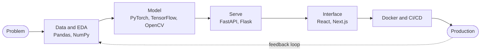
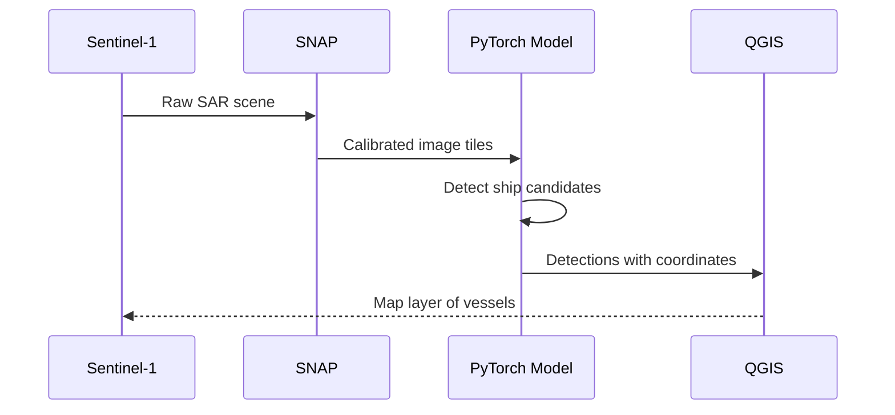

<div align="center">


<a href="https://github.com/VARUN1128">

</a>

</div>

```text
██╗   ██╗ █████╗ ██████╗ ██╗   ██╗███╗   ██╗
██║   ██║██╔══██╗██╔══██╗██║   ██║████╗  ██║
██║   ██║███████║██████╔╝██║   ██║██╔██╗ ██║
╚██╗ ██╔╝██╔══██║██╔══██╗██║   ██║██║╚██╗██║
 ╚████╔╝ ██║  ██║██║  ██║╚██████╔╝██║ ╚████║
  ╚═══╝  ╚═╝  ╚═╝╚═╝  ╚═╝ ╚═════╝ ╚═╝  ╚═══╝
```

```text
       .---.          varun@github
      / o o \         ───────────────────────────────────────────
     |   >   |        Location ..... Kochi, India
      \ \_/ /         Role ......... Junior AI Engineer
    ___/'---'\___     Education .... B.Tech CS (AI) + MBA @ The School of Future
   /  |       |  \    Focus ........ Computer Vision · LLMs · MLOps
  (___|_______|___)   Shell ........ python · typescript · c++
                      Status ....... 🟢 open to freelance / research / collabs
```

<div align="center">


<br/><br/>

<a href="mailto:varunharidas.in@gmail.com"></a>
<a href="https://www.linkedin.com/in/varun-haridas/"></a>
<a href="https://github.com/VARUN1128"></a>
<a href="https://this-is-me-tau.vercel.app"></a>

</div>

---

## `~/whoami`

```python
>>> from varun import profile
>>> profile.summary()

{
  "name":      "Varun Haridas",
  "role":      "Junior AI Engineer",
  "location":  "Kochi, India 🇮🇳",
  "education": ["B.Tech Computer Science (AI)", "MBA Candidate @ The School of Future"],
  "builds":    ["Computer Vision", "Generative AI / LLMs", "Full Stack Apps", "Backend & APIs"],
  "learning":  ["AI Agents", "RAG", "Kubernetes", "CI/CD", "MLOps"],
  "open_to":   ["Freelance", "Research", "Collaborations", "Open Source"],
  "motto":     "I build AI that ships, not just AI that demos."
}
```

## `~/system-status` &nbsp;🟢 live

<!--STATS:START-->
```text
 VARUN1128@github  ~  status
 ─────────────────────────────────────────────
 public repos ........ 126
 followers ........... 25
 stars earned ........ 58
 top languages ....... Python (24) · TypeScript (22) · Jupyter Notebook (10)
 recent commits ...... 0 (last ~90 days of public events)
 last synced ......... 2026-11-08 06:49 UTC
```
<!--STATS:END-->

<div align="center">


<br/>


</div>

## `~/pipeline` &nbsp;how I ship



## `~/stack` &nbsp;modules loaded

```text
[  OK  ] Loaded language runtime ........ python  c++  java  javascript  typescript  sql
[  OK  ] Loaded frontend layer ........... react  next.js  tailwind  html  css
[  OK  ] Loaded backend layer ............ node  express  flask  fastapi  supabase  firebase
[  OK  ] Loaded ML engine ................ pytorch  tensorflow  keras  opencv
[  OK  ] Loaded data layer ............... mongodb  mysql  pandas  numpy  matplotlib
[  OK  ] Loaded devops ................... docker  linux  git  github  vercel
[  OK  ] Loaded geo / remote sensing ..... SNAP (ESA)  QGIS
[  OK  ] Loaded integrations ............. Gemini API  MQTT  REST  Postman
[ ..   ] Loading ......................... AI agents  RAG  kubernetes  CI/CD  MLOps
```

<div align="center">


<br/>

<br/>

&nbsp;&nbsp;


</div>

## `~/projects` &nbsp;featured builds

<table>
<tr>
<td width="50%" valign="top">

#### 🛰 SAR Ship Detection
`status: deployed-in-notebook`

Deep learning model that detects ships in **Sentinel-1 SAR imagery**, which sees through clouds and darkness.


</td>
<td width="50%" valign="top">

#### 🥥 Coconut Maturity Detection
`accuracy: 87.91%`

Vision system that grades coconut maturity automatically, built for agriculture use.


</td>
</tr>
<tr>
<td width="50%" valign="top">

#### 🍳 AI Cooking Assistant
`type: software x hardware`

Automated **curry-preparation system** that connects Python automation with embedded systems.


</td>
<td width="50%" valign="top">

#### 🤖 AI Blog Generator
`engine: gemini`

Generates complete blog posts using **Google's Gemini API** behind a FastAPI backend.


</td>
</tr>
<tr>
<td colspan="2" valign="top">

#### 🏠 StayYo
`type: full-stack platform`

**AI-powered PG discovery platform** that helps people find the right place to stay.


</td>
</tr>
</table>



### `~/repos --latest` &nbsp;🟢 live from GitHub API

<!--REPOS:START-->
| Repository | Language | ⭐ | Last push |
|:--|:--|:-:|:--|
| [**fine-jar**](https://github.com/VARUN1128/fine-jar)<br/><sub></sub> | TypeScript | 0 | 2026-11-05 |
| [**vailappilli-temple**](https://github.com/VARUN1128/vailappilli-temple)<br/><sub></sub> | TypeScript | 0 | 2026-11-04 |
| [**abiah-birthday**](https://github.com/VARUN1128/abiah-birthday)<br/><sub></sub> | TypeScript | 0 | 2026-10-14 |
| [**remindAI**](https://github.com/VARUN1128/remindAI)<br/><sub></sub> | TypeScript | 0 | 2026-10-07 |
| [**kasting-kompany**](https://github.com/VARUN1128/kasting-kompany)<br/><sub></sub> | TypeScript | 0 | 2026-10-04 |
| [**kk**](https://github.com/VARUN1128/kk)<br/><sub></sub> | TypeScript | 0 | 2026-10-04 |
<!--REPOS:END-->

## `~/achievements` &nbsp;unlocked

```text
┌──────────────────────────────────────────────────────────────────┐
│  🏆  [ UNLOCKED ]  WINNER ........ Money Conclave 2024           │
│  🥈  [ UNLOCKED ]  RUNNER-UP ..... Dev Summit 2023               │
│  🥈  [ UNLOCKED ]  RUNNER-UP ..... PERCEPTION Hackathon          │
│  🥈  [ UNLOCKED ]  RUNNER-UP ..... Rural India Agri Hackathon    │
│  🏅  [ UNLOCKED ]  FINALIST ...... V-Guard Big Idea Design Comp. │
├──────────────────────────────────────────────────────────────────┤
│  🎓  NPTEL Deep Learning (Elite)       🎓  SQL Advanced          │
│  🎓  Software Engineer Certification   🎓  Google Analytics      │
│  🎓  Cambridge Linguaskill B2          🎓  Geo Mapping           │
└──────────────────────────────────────────────────────────────────┘
```

<div align="center">


<br/>


<br/>


</div>

## `~/activity` &nbsp;contribution graph

<!--GRAPH:START-->
```text
 >_ syncing contribution graph ...
```
<!--GRAPH:END-->

## `~/contact`

```bash
$ ping varun
64 bytes from varun: icmp_seq=1 ttl=64 time=0.1 ms   # replies fast

$ cat /etc/varun/open_to
freelance · research · collaborations · open-source
```

<div align="center">

<a href="mailto:varunharidas.in@gmail.com"></a>
<a href="https://this-is-me-tau.vercel.app"></a>
<a href="https://www.linkedin.com/in/varun-haridas/"></a>

<br/><br/>


</div>
