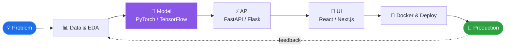

<!-- ═══════════════ HEADER ═══════════════ -->
<div align="center">


<a href="https://github.com/VARUN1128">

</a>

<br/>


<br/><br/>

<a href="mailto:varunharidas.in@gmail.com"></a>
<a href="https://www.linkedin.com/in/varun-haridas/"></a>
<a href="https://github.com/VARUN1128"></a>
<a href="https://this-is-me-tau.vercel.app"></a>

<br/>


</div>

<br/>

<!-- ═══════════════ ABOUT ═══════════════ -->
## 💫 &nbsp;Who Am I?

<table>
<tr>
<td width="55%" valign="top">

```python
class VarunHaridas:
    location  = "Kochi, India 🇮🇳"
    role      = "Junior AI Engineer"
    education = [
        "B.Tech Computer Science (AI)",
        "MBA Candidate @ The School of Future",
    ]
    superpowers = [
        "Computer Vision",
        "Deep Learning",
        "LLMs & Generative AI",
        "Full Stack Development",
    ]
    currently_learning = [
        "AI Agents", "RAG", "Kubernetes",
        "CI/CD", "MLOps",
    ]
    open_to = [
        "Freelance", "Research",
        "Collaborations", "Open Source",
    ]

    def pitch(self):
        return "I build AI that ships, not just AI that demos."
```

</td>
<td width="45%" valign="middle" align="center">


</td>
</tr>
</table>

<div align="center">


</div>

<br/>

<!-- ═══════════════ WORKFLOW ═══════════════ -->
## ⚙️ &nbsp;How I Build



<br/>

<!-- ═══════════════ TECH STACK ═══════════════ -->
## 🧰 &nbsp;Tech Arsenal

<div align="center">

| | |
|:---:|:---|
| **🗣 Languages** |  |
| **🎨 Frontend** |  |
| **⚙️ Backend** |  |
| **🧠 AI / ML** |    |
| **🗄 Databases** |  |
| **☁️ DevOps & Tools** |  |

</div>

<details>
<summary><b>🔧 Also worked with (click to expand)</b></summary>
<br/>


</details>

<br/>

<!-- ═══════════════ PROJECTS ═══════════════ -->
## 🚀 &nbsp;Featured Projects

<table>
<tr>
<td width="50%" valign="top">

### 🛰 SAR Ship Detection
Deep learning model that spots ships in **Sentinel-1 SAR satellite imagery**, day or night, through clouds.


</td>
<td width="50%" valign="top">

### 🥥 Coconut Maturity Detection
Vision system that grades coconut maturity with **87.91% accuracy**.


</td>
</tr>
<tr>
<td width="50%" valign="top">

### 🍳 AI Cooking Assistant
AI-powered **automated curry preparation** system where software meets the kitchen.


</td>
<td width="50%" valign="top">

### 🤖 AI Blog Generator
Generates complete blog posts using **Google's Gemini API**, served through a fast backend.


</td>
</tr>
<tr>
<td colspan="2" align="center" valign="top">

### 🏠 StayYo
**AI-powered PG discovery platform** helping people find the right place to stay.


</td>
</tr>
</table>

<div align="center">
<a href="https://github.com/VARUN1128?tab=repositories"></a>
</div>

<br/>

<!-- ═══════════════ ACHIEVEMENTS ═══════════════ -->
## 🏆 &nbsp;Wins & Recognition

<div align="center">

| 🏅 | Achievement |
|:---:|:---|
| 🥇 | **Winner** — Money Conclave 2024 |
| 🥈 | **Runner-up** — Dev Summit 2023 |
| 🥈 | **Runner-up** — PERCEPTION Hackathon |
| 🥈 | **Runner-up** — Rural India Agri Hackathon |
| 🎖 | **Finalist** — V-Guard Big Idea Design Competition |

</div>

<details>
<summary><b>📜 Certifications</b></summary>
<br/>


</details>

<br/>

<!-- ═══════════════ FOCUS ═══════════════ -->
## 🎯 &nbsp;Current Focus

<div align="center">


</div>

<br/>

<!-- ═══════════════ ACTIVITY ═══════════════ -->
## 📈 &nbsp;Activity

<div align="center">


<br/><br/>


<br/><br/>

<!-- 🐍 Snake animation: needs the workflow in .github/workflows/snake.yml (see snake.yml) -->
<picture>
  <source media="(prefers-color-scheme: dark)" srcset="https://raw.githubusercontent.com/VARUN1128/VARUN1128/output/github-snake-dark.svg"/>
  <source media="(prefers-color-scheme: light)" srcset="https://raw.githubusercontent.com/VARUN1128/VARUN1128/output/github-snake.svg"/>
  
</picture>

</div>

<br/>

<!-- ═══════════════ CONTACT ═══════════════ -->
## 📫 &nbsp;Let's Build Something

<div align="center">

> *"Have a problem that needs AI? Let's talk."*

<a href="mailto:varunharidas.in@gmail.com"></a>
<a href="https://this-is-me-tau.vercel.app"></a>
<a href="https://www.linkedin.com/in/varun-haridas/"></a>

<br/><br/>


</div>
